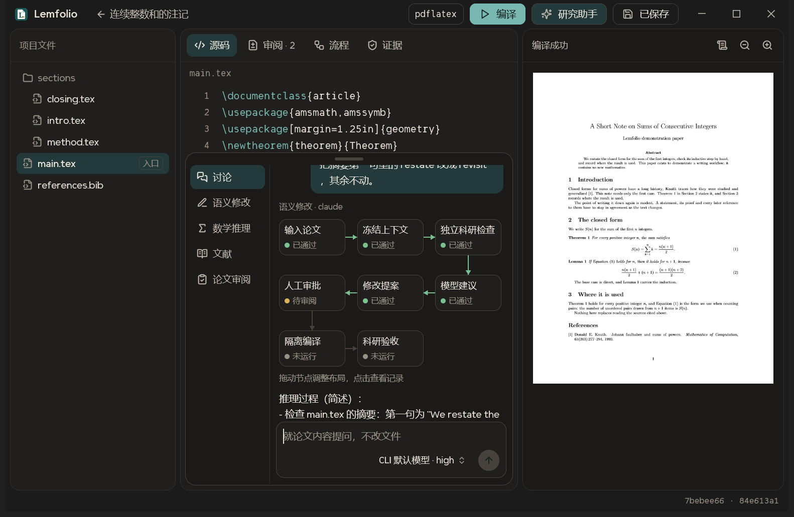
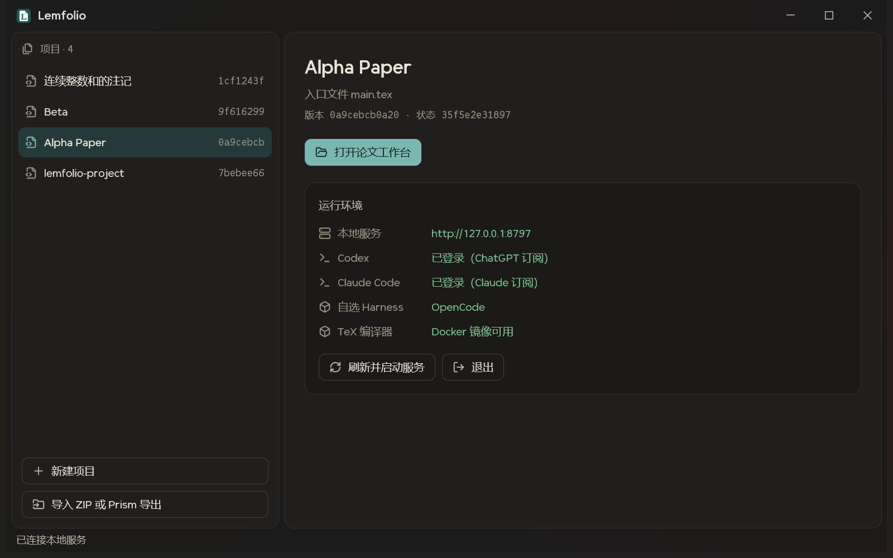
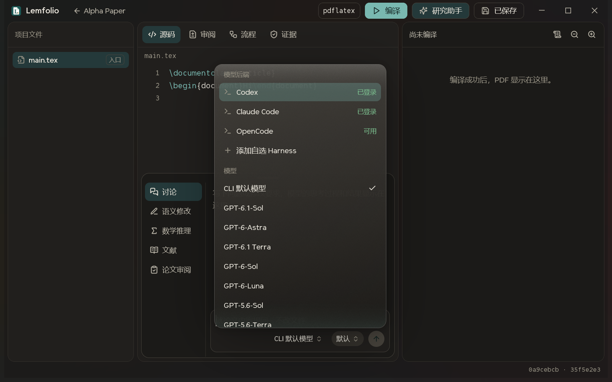
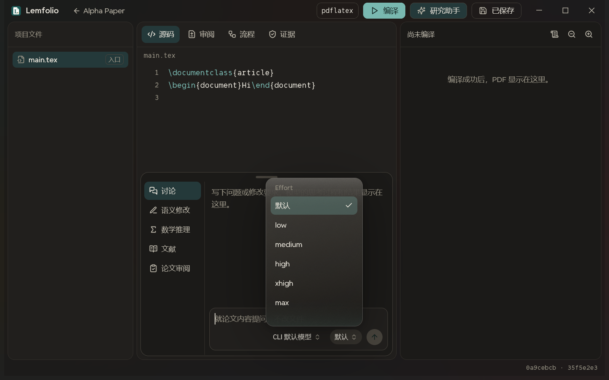
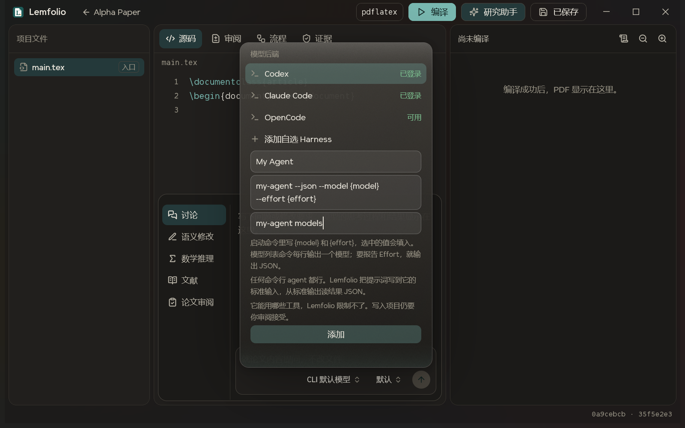
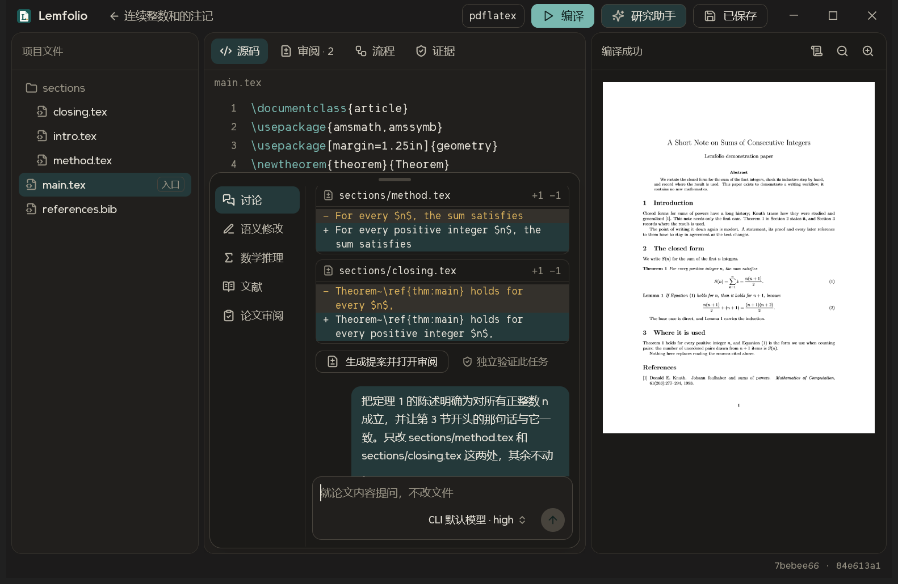
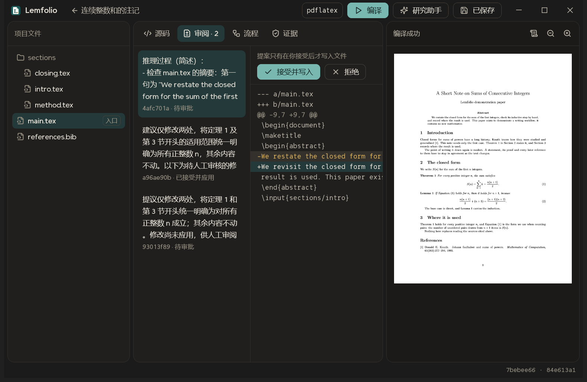

# Lemfolio

**中文** | [English](README_en.md)

From Lemma to Paper. 用你自己的 Claude、Codex 或任何命令行 agent 改论文，每一处改动都由你决定。

Lemfolio 是运行在本机的论文工作台。源码、PDF 和研究助手在同一个桌面窗口里。模型只提出修改建议，你接受后才写入文件。



## 配置

### 1. 安装依赖

目前只支持 Windows 10 及以上版本。需要先装好：

| 软件 | 用途 |
|---|---|
| Python 3.11+ | 本地服务 |
| Node.js | 构建前端资源 |
| Rust MSVC 工具链 | 构建桌面程序 |
| Git | 项目快照 |
| Docker Desktop（Linux 容器） | 隔离编译 LaTeX |
| 一个命令行 agent | 研究助手。Codex CLI、Claude Code，或者你自己的（见第 5 步） |

### 2. 构建

在 PowerShell 里运行：

```powershell
git clone https://github.com/h1n4k0/lemfolio.git
cd lemfolio
.\scripts\setup.ps1 -BuildTex -BuildNative
```

脚本只在项目目录内创建虚拟环境和依赖，并构建桌面程序和 `lemfolio/tex:0.1` 镜像。它不会改动系统 Python、CLI 的配置或登录凭据。构建镜像前要先启动 Docker Desktop。

### 3. 登录模型 CLI

在你自己的终端里登录官方 CLI，用哪个就登录哪个：

```powershell
codex login
claude auth login
```

Lemfolio 直接使用 CLI 管理的登录状态，不读取也不复制登录令牌。两个都没有也可以，跳过这一步，在第 5 步添加你自己的 agent。

### 4. 启动并检查运行环境

```powershell
.\scripts\start.ps1 -Native
```

项目数据保存在项目目录的 `data` 文件夹。要放到别处，先设置环境变量 `LEMFOLIO_DATA`。

启动后先看窗口右侧的“运行环境”。本地服务和 TeX 编译器必须是绿色；Codex、Claude Code 和“自选 Harness”至少要有一项可用：



| 这一项不正常时 | 怎么处理 |
|---|---|
| 本地服务连不上 | 点“刷新并启动服务”；提示缺少 Python 环境时，重新运行第 2 步 |
| Codex 或 Claude Code 显示“未通过订阅登录” | 运行界面提示的登录命令 |
| Codex 或 Claude Code 显示“未安装官方 CLI” | 安装后点“刷新并启动服务” |
| TeX 编译器不可用 | 启动 Docker Desktop，再运行 `.\scripts\setup.ps1 -BuildTex` |

在左侧新建项目，或者导入 ZIP，然后点“打开论文工作台”。

### 5. 选择模型和 Effort

点“研究助手”打开抽屉，再点输入框右下角的模型按钮：



- **模型后端：** 列出 Codex、Claude Code、本机装好的 OpenCode，以及你添加的命令。没有登录或找不到的后端不能选。
- **模型：** 列表来自 CLI 自己的报告，所以不同版本看到的不一样。“CLI 默认模型”表示不指定模型。
- **Effort：** 模型按钮旁边的按钮，点开是一个单独的弹窗。“默认”表示交给 CLI 决定；没选模型时只列出所有模型都支持的级别。后端没有报告 effort 时不显示这个按钮。



**没有 Codex 或 Claude Code，也不想配 API？** 点“添加自选 Harness”，填一个名称和启动命令：



任何命令行 agent 都可以，只要它满足两点：

1. 从标准输入读取提示词。
2. 把结果写到标准输出，结果是一个 JSON 对象：`{"answer": "...", "changes": [], "checks": []}`。外面包一层代码块或事件流也能读出来。

命令不经过 shell，所以管道和重定向不会生效。配置保存在数据目录的 `runtime/harnesses.json`，点行尾的 × 可以移除。

**让它也能选模型和 Effort：** 这一步可选，不填的话，模型和账号由启动命令决定。

- 在启动命令里写 `{model}` 和 `{effort}`，例如 `my-agent --json --model {model} --effort {effort}`。选中的值会填进去；没选时，这一项连同它前面的选项名一起去掉。
- 在“模型列表命令”里填一条能列出模型的命令，例如 `my-agent models`。它可以每行输出一个模型，也可以输出 JSON 来报告 Effort：

```json
{"models": [{"id": "large", "name": "Large", "efforts": ["low", "high", "max"], "default_effort": "high"}]}
```

添加时 Lemfolio 会实际运行一次这条命令，没有输出模型就不会添加。列表和 Effort 只显示这条命令报告的内容；启动命令里没有 `{effort}` 时，不显示 Effort。

**这条路的边界不一样：** Codex、Claude Code 和 OpenCode 由 Lemfolio 关掉工具后运行；你添加的命令能用哪些工具，Lemfolio 限制不了，它会在一个空的临时目录里、以你的权限运行。它的建议仍要经过审阅才写入项目，但它自己碰到的文件和产生的费用由这个命令决定。只添加你信任的命令。OpenCode 按你在 OpenCode 里配置的账号和计费走，Lemfolio 不会替你自动选它。

### 6. 提出修改并决定是否写入

在抽屉左侧选一种模式，写下要求后发送。

| 模式 | 作用 |
|---|---|
| 讨论 | 就论文内容提问，不改文件 |
| 语义修改 | 说明要改什么，结果进入审阅 |
| 数学推理 | 把等式写进反引号，由 SymPy 独立检查，例如 `` `(x+1)**2 = x**2+2*x+1` `` |
| 文献 | 可以直接写 DOI 或 arXiv 编号，会核验元数据 |
| 论文审阅 | 审阅论断、假设与证据，不改文件 |

**Claude Code 的运行**显示为工作流图，状态来自后端记录。节点可以拖动，点击可以查看记录。

**Codex 和其他后端的运行**显示 CLI 返回的摘要和修改 diff。CLI 没有返回摘要时，界面会直接说明：



点“生成提案并打开审阅”，然后在审阅页决定。**只有点了“接受并写入”，文件才会改变：**



如果生成提案后项目又变了，旧提案会被拒绝，不能写入。这时需要基于当前版本重新生成。

### 可选设置

| 设置 | 方法 |
|---|---|
| 界面语言 | 默认跟随系统；也可以给桌面程序加 `--lang en` |
| 端口 | `.\scripts\start.ps1 -Native -Port 8800` |
| 编译引擎 | 点工作台顶部的 `pdflatex`，在 pdfLaTeX、XeLaTeX、LuaLaTeX 之间切换 |
| API 模型 | 设置 `LEMFOLIO_API_KEY` 和 `LEMFOLIO_API_MODEL`，只在浏览器工作台里手动选择；不会自动启用。不要把密钥写进代码 |

## 浏览器工作台

`.\scripts\start.ps1` 不带 `-Native` 时只启动本地服务，然后用浏览器打开 <http://127.0.0.1:8765>。

查找替换、SyncTeX、大纲、文献和历史面板目前只在浏览器工作台里有。工作流图、Effort 选择器和自选 Harness 目前只在桌面窗口里有。

## 安全与边界

- **模型权限：** 模型只收到冻结的论文上下文，返回结构化建议。Codex、Claude Code 和 OpenCode 没有工作区写工具；你自己添加的命令不在这个保证之内。
- **编译隔离：** 编译容器没有网络，源目录只读，禁止 shell escape，并限制进程、CPU、内存、时间和输出。
- **本机访问：** API 只监听本机地址，并校验会话和 CSRF。它不是公网多用户认证。
- **编译成功：** 只表示排版生成成功，不表示数学正确。
- **SymPy 检查：** 是带假设的有限表达式等价检查，不是通用定理证明器。
- **文献核验：** 核验元数据和来源，不验证文献结论。
- **模型自述的检查：** 只是模型的陈述。独立验证和编译记录分开保存。
- **中断的任务：** 重启后可以查看，但不会自动续跑。需要重新检查版本后创建新任务。

## 开发

```powershell
npm run check
npm run build
npm run test:web
.\.venv\Scripts\python.exe -m pytest -q
cargo test --manifest-path rust/lemfolio-diff/Cargo.toml --target-dir target/diff
Push-Location native; cargo test --locked; Pop-Location
```

接口协议的唯一来源是 `contracts/v1/schema.json`。修改后运行 `scripts/generate_contracts.py`、`scripts/generate_openapi.py` 和 `npm run build`；`scripts/check.ps1` 会检查生成文件是否一致。

更多资料：[工作台设计](docs/frontend.md)、[架构](docs/architecture.md)、[运行时](docs/runtime.md)、[Keel 复用](docs/keel-reuse.md)。其中部分文档写于桌面工作台之前，以本文为准。

## 许可证

Lemfolio 使用 [PolyForm Noncommercial License 1.0.0](LICENSE.md)：可以查看、修改和分发，但仅限非商业用途。它不是开源许可证。商业使用请通过 <https://github.com/h1n4k0> 联系作者。

Keel 字体是专有字体，不适用这份许可证。字体和第三方内容的条款见 [NOTICE](NOTICE.md)。
