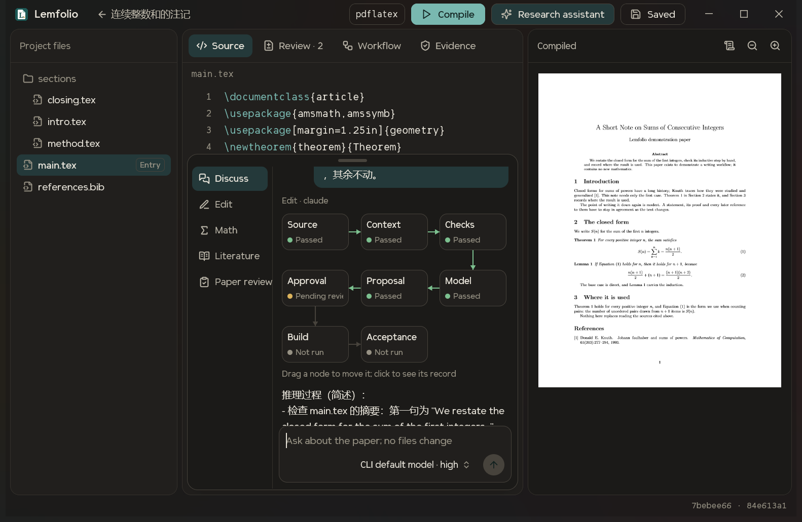
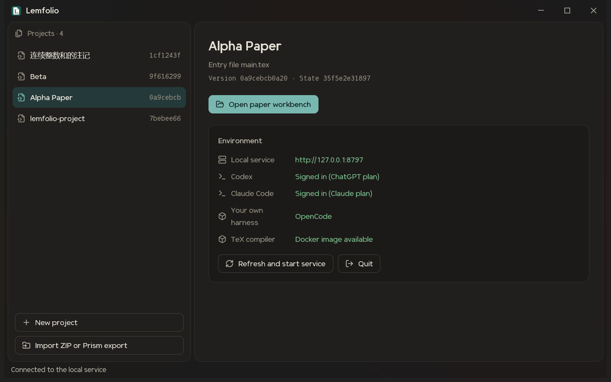
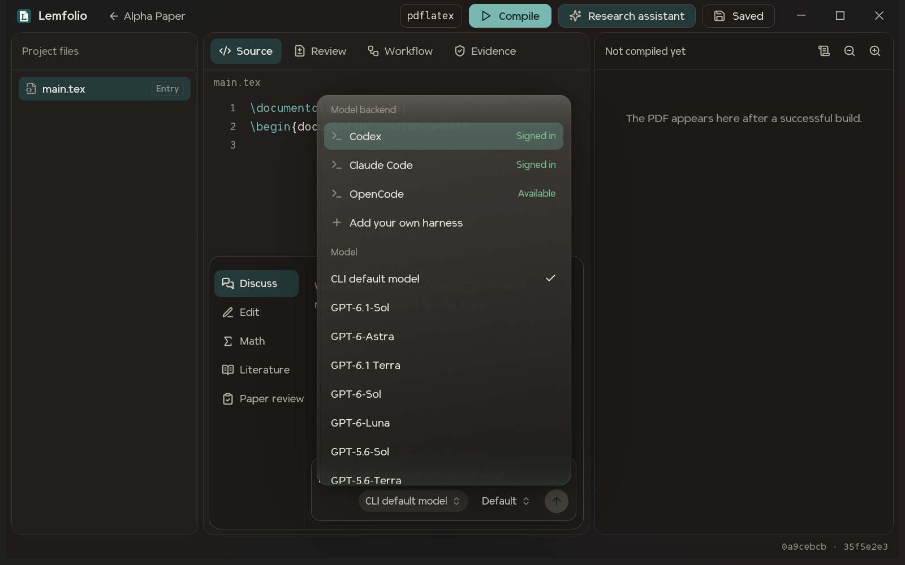
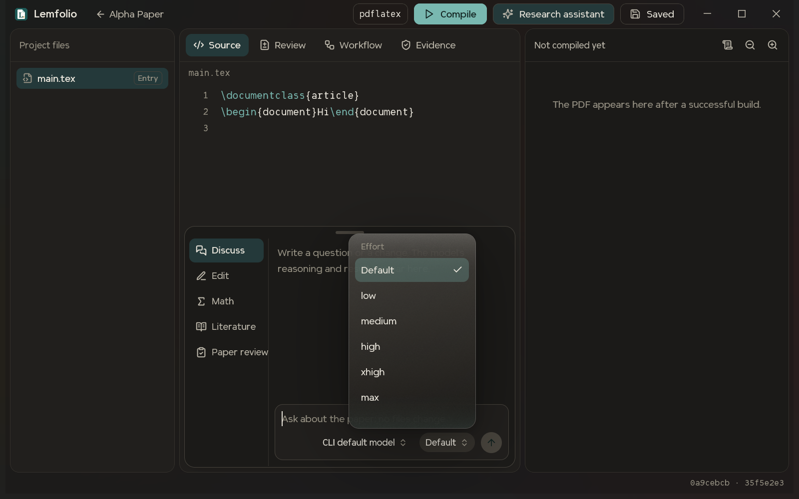
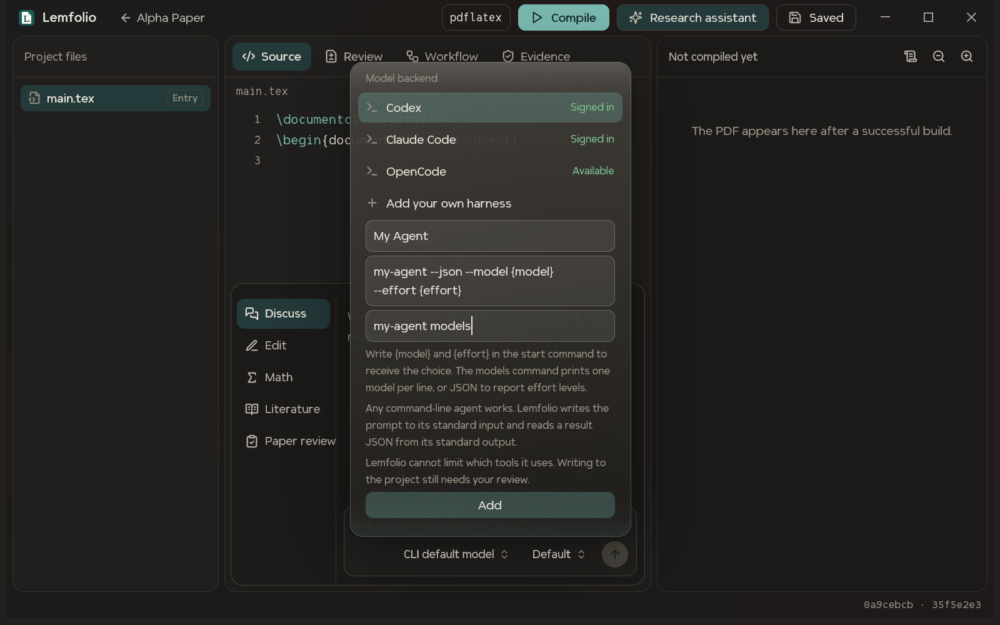
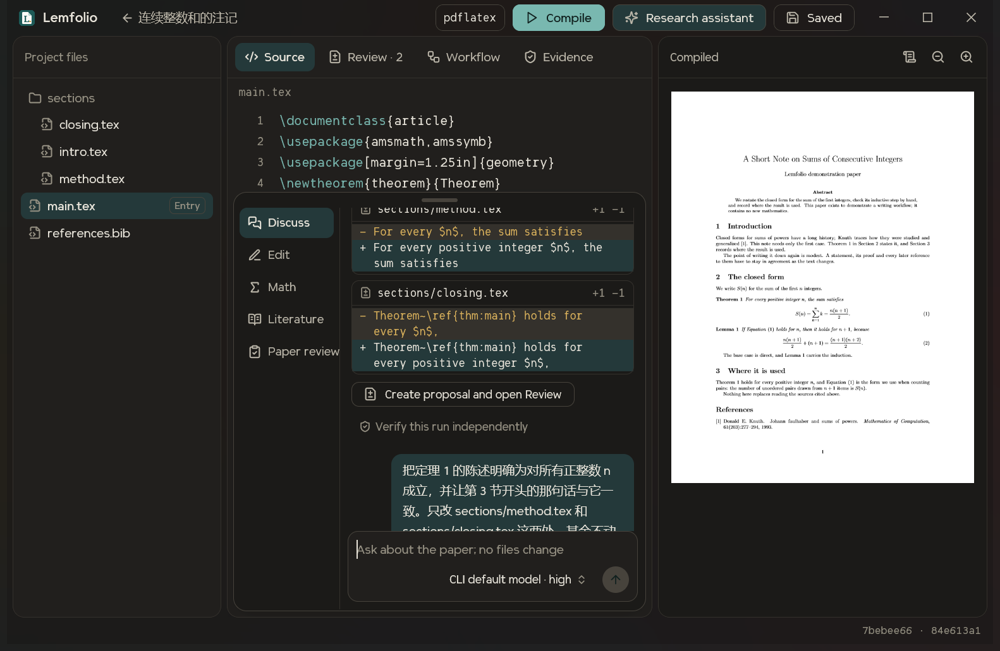
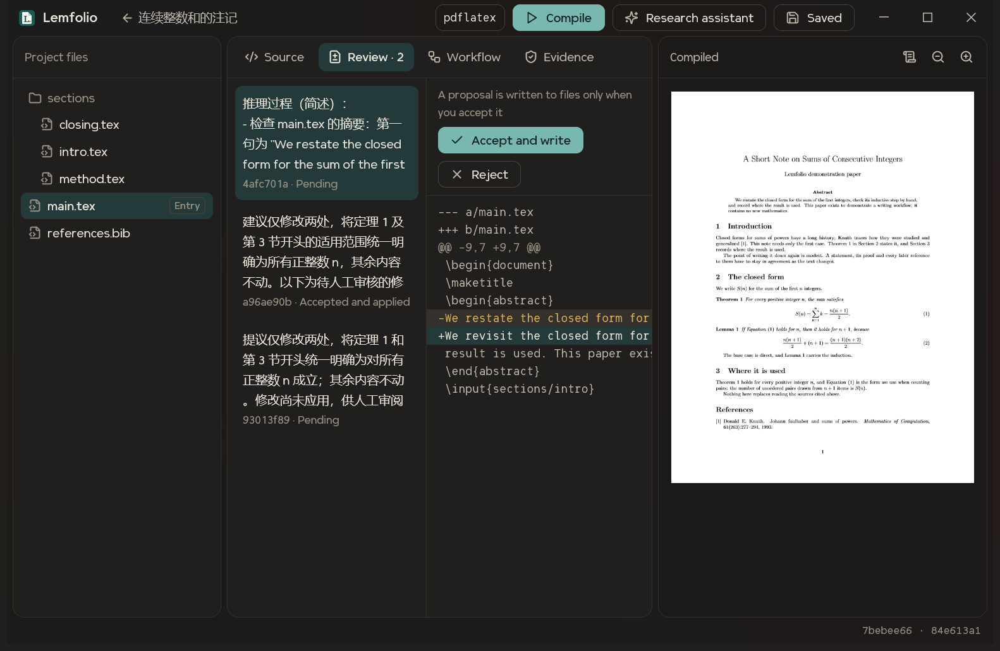

# Lemfolio

[中文](README.md) | **English**

From Lemma to Paper. Edit your paper with your own Claude, Codex or any command-line agent, and decide on every change yourself.

Lemfolio is a paper workbench that runs on your own computer. Source, PDF and research assistant share one desktop window. Models only suggest changes, and nothing is written to a file until you accept it.



## Install

Download `Lemfolio-<version>-Setup-x64.exe` from [Releases](https://github.com/h1n4k0/lemfolio/releases/latest) and run it. It needs no administrator rights, and no Python, Node.js or Rust. You choose the folder during setup; project data lives in its `data` folder and is kept when you uninstall.

The installer is not code-signed yet, so Windows may show "Windows protected your PC". Once you have confirmed the file came from the Releases page above, choose "More info", then "Run anyway".

You still install Git, Docker Desktop and a command-line agent yourself (see the table below). With Docker Desktop running, run "Build TeX image" from the Start menu once to enable LaTeX builds. For signing in to a CLI and using the app, continue from step 3.

## Set up from source

### 1. Install the prerequisites

Lemfolio currently supports Windows 10 and later only. You need:

| Software | Used for |
|---|---|
| Python 3.11+ | The local service |
| Node.js | Building frontend assets |
| Rust MSVC toolchain | Building the desktop app |
| Git | Project snapshots |
| Docker Desktop (Linux containers) | Isolated LaTeX builds |
| A command-line agent | The research assistant: Codex CLI, Claude Code, or your own (see step 5) |

### 2. Build

In PowerShell:

```powershell
git clone https://github.com/h1n4k0/lemfolio.git
cd lemfolio
.\scripts\setup.ps1 -BuildTex -BuildNative
```

The script creates a virtual environment and dependencies inside the project folder, then builds the desktop app and the `lemfolio/tex:0.1` image. It does not change your system Python, CLI settings or login credentials. Start Docker Desktop before building the image.

### 3. Sign in to a model CLI

Sign in to the official CLI you want to use, in your own terminal:

```powershell
codex login
claude auth login
```

Lemfolio uses the login the CLI manages. It does not read or copy your tokens. If you have neither, skip this step and add your own agent in step 5.

### 4. Start and check the environment

```powershell
.\scripts\start.ps1 -Native
```

Project data is stored in the `data` folder inside the project. To keep it elsewhere, set the `LEMFOLIO_DATA` environment variable first.

Once the window opens, look at the Environment panel on the right. The local service and TeX compiler must be green, and at least one of Codex, Claude Code and "Your own harness" must be available:



| If this row is wrong | Do this |
|---|---|
| The local service cannot connect | Click **Refresh and start service**. If it reports a missing Python environment, run step 2 again |
| Codex or Claude Code says "Not signed in with a subscription" | Run the sign-in command it shows |
| Codex or Claude Code says "Official CLI not installed" | Install it, then click **Refresh and start service** |
| The TeX compiler is unavailable | Start Docker Desktop, then run `.\scripts\setup.ps1 -BuildTex` |

Create a project on the left or import a ZIP, then click **Open paper workbench**.

### 5. Choose a model and effort

Click **Research assistant** to open the drawer, then click the model button at the bottom right of the input box:



- **Model backend:** Lists Codex, Claude Code, OpenCode if it is installed, and any commands you added. A backend that is not signed in or cannot be found cannot be selected.
- **Model:** The list comes from the CLI itself, so it varies by version. **CLI default model** names no model.
- **Effort:** The button beside the model button opens its own popup. **Default** leaves the choice to the CLI. With no model chosen, it only offers levels that every listed model accepts. The button is hidden when a backend reports no effort levels.



**No Codex or Claude Code, and no wish to set up an API?** Click **Add your own harness**, then enter a name and a start command:



Any command-line agent works if it does two things:

1. It reads the prompt from standard input.
2. It writes the result to standard output as one JSON object: `{"answer": "...", "changes": [], "checks": []}`. A code fence or an event stream around it can still be read.

The command does not run through a shell, so pipes and redirects have no effect. The setting is stored in `runtime/harnesses.json` in the data folder. Click the × at the end of its row to remove it.

**Choosing a model and effort for it.** This is optional. Without it, the start command decides the model and account.

- Write `{model}` and `{effort}` in the start command, for example `my-agent --json --model {model} --effort {effort}`. The choice is filled in. With nothing chosen, that argument and the option name before it are dropped.
- Enter a command that lists models under **Models command**, for example `my-agent models`. It can print one model per line, or JSON to report effort levels:

```json
{"models": [{"id": "large", "name": "Large", "efforts": ["low", "high", "max"], "default_effort": "high"}]}
```

Lemfolio runs this command once when you add the harness, and refuses it if it prints no models. The lists show only what this command reports. Effort is hidden if the start command has no `{effort}`.

**This route has different limits.** Lemfolio turns tools off for Codex, Claude Code and OpenCode. It cannot limit the tools of a command you add, which runs with your permissions in an empty temporary folder. Its suggestions still need your review before they are written to the project, but what it touches and what it costs are up to that command. Only add commands you trust. OpenCode uses the account and billing you set up in OpenCode, and Lemfolio never selects it for you.

### 6. Request a change and decide whether to write it

Choose a mode on the left of the drawer, write your request and send it.

| Mode | What it does |
|---|---|
| Discuss | Ask about the paper; no files change |
| Edit | Describe a change; the result goes to Review |
| Math | Put equations in backticks for an independent SymPy check, such as `` `(x+1)**2 = x**2+2*x+1` `` |
| Literature | Write a DOI or arXiv ID directly to verify its metadata |
| Paper review | Review claims, assumptions and evidence; no files change |

**Claude Code runs** appear as a workflow graph, with statuses from the backend's records. Drag a node to move it, or click it to read its record.

**Codex and other runs** show the summary the CLI returned and a diff of the changes. If the CLI returned no summary, the window says so:



Click **Create proposal and open Review**, then decide on the Review tab. **Files change only when you click Accept and write:**



If the project changes after a proposal is created, the old proposal is refused and cannot be written. Generate a new one from the current version.

### Optional settings

| Setting | How |
|---|---|
| Interface language | Follows the system by default; or pass `--lang en` to the desktop app |
| Port | `.\scripts\start.ps1 -Native -Port 8800` |
| Build engine | Click `pdflatex` at the top of the workbench to switch between pdfLaTeX, XeLaTeX and LuaLaTeX |
| API model | Set `LEMFOLIO_API_KEY` and `LEMFOLIO_API_MODEL`, then select it by hand in the browser workbench; it is never enabled automatically. Do not put keys in code |

## Browser workbench

`.\scripts\start.ps1` without `-Native` starts only the local service. Then open <http://127.0.0.1:8765> in a browser.

Find and replace, SyncTeX, and the outline, literature and history panels are currently in the browser workbench only. The workflow graph, effort picker and your own harnesses are currently in the desktop window only.

## Safety and limits

- **Model access:** Models receive a frozen copy of the paper's context and return structured suggestions. Codex, Claude Code and OpenCode have no tools for writing to the workspace. Commands you add yourself are outside this guarantee.
- **Build isolation:** Build containers have no network and a read-only source folder. Shell escape is off, and processes, CPU, memory, time and output are limited.
- **Local access:** The API listens on the local address only and checks a session and CSRF token. This is not multi-user authentication for the internet.
- **Successful builds:** A build that succeeds shows the paper typeset, not that the mathematics is correct.
- **SymPy checks:** These are bounded equivalence checks under stated assumptions, not a general theorem prover.
- **Literature checks:** These verify metadata and sources, not a paper's conclusions.
- **Checks the model reports:** These are the model's own statements. Independent verification and build records are stored separately.
- **Interrupted runs:** You can read them after a restart, but they do not resume. Check the version again and create a new run.

## Development

```powershell
npm run check
npm run build
npm run test:web
.\.venv\Scripts\python.exe -m pytest -q
cargo test --manifest-path rust/lemfolio-diff/Cargo.toml --target-dir target/diff
Push-Location native; cargo test --locked; Pop-Location
```

`contracts/v1/schema.json` is the single source for the API contract. After changing it, run `scripts/generate_contracts.py`, `scripts/generate_openapi.py` and `npm run build`. `scripts/check.ps1` checks that generated files match.

More detail: [workbench design](docs/frontend.md), [architecture](docs/architecture.md), [runtime](docs/runtime.md) and [Keel reuse](docs/keel-reuse.md). Some of these predate the desktop workbench; where they differ, this README is current.

## License

Lemfolio is licensed under the [PolyForm Noncommercial License 1.0.0](LICENSE.md). You may view, change and share it for noncommercial purposes only. It is not an open source license. For commercial use, contact the author through <https://github.com/h1n4k0>.

The Keel fonts are proprietary and are not covered by this license. See [NOTICE](NOTICE.md) for the terms of the fonts and third-party content.
