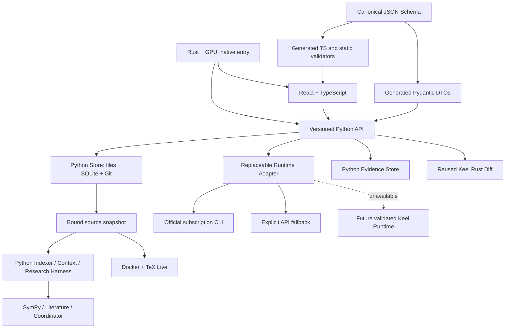

# Architecture — protocol 1.0.0

Local-first, provider-replaceable AI research workspace. Second-review baseline: `8939e279b5f97bbd63207b2dc516fe5c510f2c2c`; implementation branch: `review/architecture-hardening-20261030`. The Python Research Harness is retained.

## Source identity

`revision` remains SHA-256 of raw file hashes. `state_revision` also binds `main_file` and monotonic managed generation. Entry changes and managed A→B→A edits invalidate prior approvals. History stores main entry and unique commit/state identity; UI restore sends the selected commit rather than an ambiguous content hash.

`capture_project` serializes managed writes, opens one SQLite transaction, scans bytes once and derives all text/hashes/metadata from that capture. Index, context, tools and Compiler use those same bytes. Model tasks additionally bind an immutable archive digest/manifest; proposal and task verification reload it. Non-UTF8 data stays in the raw archive/manifest but is not invented as visible text. This is not an OS snapshot against arbitrary concurrent same-user external writers; before/after hash equality is not used as proof of atomicity.

## Editing and context

The Python Context Engine prioritizes include/reference dependencies and explicitly reports omitted files/nodes/edges. Coverage records completeness, raw SHA, decoded character and original UTF-8 byte ranges including BOM offsets. Source characters and entire serialized context are both bounded, followed by complete-task byte admission.

Full-file replacement requires complete hash-bound visibility. Truncated files use local anchor edits. The API checks result policy again, reloads frozen full bytes, requires each nonempty anchor exactly once inside visible coverage, rejects overlap, and reconstructs unchanged unseen text/BOM/newlines. Store then accepts only a digest/state-bound proposal. A missing operation is not deletion; explicit manual null content is separate.

## Approval and independent evidence

The file journal belongs to the outer SQL transaction. Exceptions after file application but before approval/commit immediately restore files and metadata. Once Store commits, applied source is durable and independent of scientific verification.

`DecisionResponse` separates `apply_status`, `verification_status` and structured retryable errors. Verifier/compiler/evidence failure cannot claim that applied source was not applied. Verification is persisted as pending before work; restart marks an unfinished pending phase as interrupted failure. Retry captures the exact same approved state, creates a new verification record and never reapplies source.

Build identity binds project/snapshot/state/content/hashes/main/engine/image ID; successful verification also checks actual artifact hashes. Legacy receipts remain history. React scopes project/run/build selections separately, cancels old SSE/polls, clears PDF on new/failed/cancelled builds and entry changes, and labels explicit history. A newer log never appears beside an old PDF as though they belonged together.

## Visual workflow

The user-selected addition is an operational view of the existing workflow, not a drag-and-drop scheduler. Python `workflow.py` is a pure projection of persisted records into eight stages: source, frozen context, research tools, model, proposal, human approval, compilation and independent verification. Its versioned `WorkflowView`/node/action/evidence DTOs share the same canonical schema as the rest of the API.

Nodes join a selected run to its own proposal and verification lineage. Input state, approved output state and current state are separate; old or unrelated runs/builds cannot fill missing stages. A successful compilation node requires a bound receipt and checked PDF bytes. A completed model or accepted source never sets scientific acceptance; human review remains explicit. With no selected run, real manual proposals/builds are inspectable without inventing AI work.

Clicking a node opens its details and evidence. Separate action buttons reuse existing methods and their state/digest/dirty guards. Creating a proposal and accepting its Diff are distinct operations. Historical or blocked mutation actions are disabled; retrying a failed verification does not reapply source. Graph edges describe the research relationship, not an automatic executor. The React controller gives workflow requests their own selection token so a delayed response cannot replace another project/run's view.

## Paper workbench

The React workbench, its evidence vocabulary, SyncTeX routes, acceptance results and known limits are described in [frontend](frontend.md). The workflow view above is one tab inside it; the Python projection is unchanged.

## Runtime and contracts

Runtime queued state/event and final result/result-event/completed state use single transactions. On Windows 10+, `processes.py` creates subscription CLI executions and authentication probes with `PROC_THREAD_ATTRIBUTE_JOB_LIST`: the kernel assigns the process to an unnamed, non-inheritable kill-on-close Job before its first instruction. Only standard pipe handles are inherited; neither breakaway flag is enabled. Closing the sole Job handle, including abrupt owner death, terminates ordinary CreateProcess descendants. Cleanup also runs when the direct CLI exits normally so descendants cannot retain the output pipes. There is no unguarded startup fallback; unsupported platforms/Job policy reject CLI execution.

Launch, runtime registration and durable `run_guards` metadata are serialized with cancellation/close. A closed runtime cannot launch a late child; authentication probes complete under the same bounded close lock. Guard persistence failure kills and closes the created process. The runtime data-directory lock is not released while a protected launch is still being admitted. Restart preserves `interrupted` and does not replay work. `process_ownership` identifies a successfully persisted guard; `prior_cli_termination_confirmed` remains false because startup does not inspect individual old processes. Legacy or pre-registration crashes remain unknown in metadata, without inventing evidence. Automatic or cross-provider execution/authorization continuation remains unsupported.

`contracts/v1/schema.json` generates Pydantic DTOs, TS interfaces and build-time Ajv standalone validators. OpenAPI carries the same canonical constraints plus version/digest. Explicit incompatible versions are refused. Browser CSP remains `script-src 'self'`; validators require no dynamic evaluation.

CLI status and run share an environment without inherited API keys/auth-token/alternative-provider overrides. Updates are disabled only in owned children. Claude must report `claude.ai`/firstParty login, Codex explicitly ChatGPT. No credential files are read or copied. Paid API fallback requires explicit configuration/selection. Existing Claude 2.1.283 validation uses its explicit path and does not install or change the system default.

## Compiler limits and remaining boundaries

Docker retains disabled network/shell escape/rc, read-only root/source, non-root, cap drop/no-new-privileges and pids/CPU/memory/file/tmpfs/time limits. Admission also bounds simultaneous builds/queries, retained count and conservatively reserved storage/free space. SyncTeX containers are named, output-bounded, owned durably and cleaned on timeout/restart. Unconfirmed cleanup blocks admission. Aggregate output polling is a soft bound, not a host filesystem hard quota.

Research claims require human review; symbolic equality, citation metadata and compilation are distinct evidence. General TeX macro expansion, universal proofs and hostile same-user isolation are not claimed solved. Windows Job ownership is a lifetime guarantee for the ordinary CLI process tree, not a sandbox against external services/brokers or malicious same-user code. Other platforms require a separately validated ownership backend before CLI execution is enabled. Keel Runtime stays unavailable until independently validated, without blocking the retained Keel file/Diff reuse. GPUI is the native entry and React the browser editor; no embedded GPUI editor or public deployment is claimed.

An existing service is not automatically updated by building a branch; launch frontend/backend from matching protocol sources.
